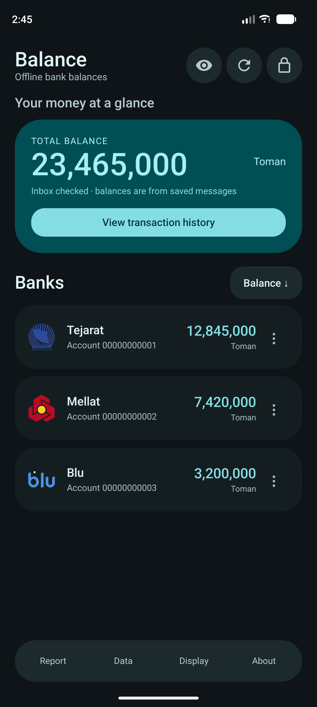
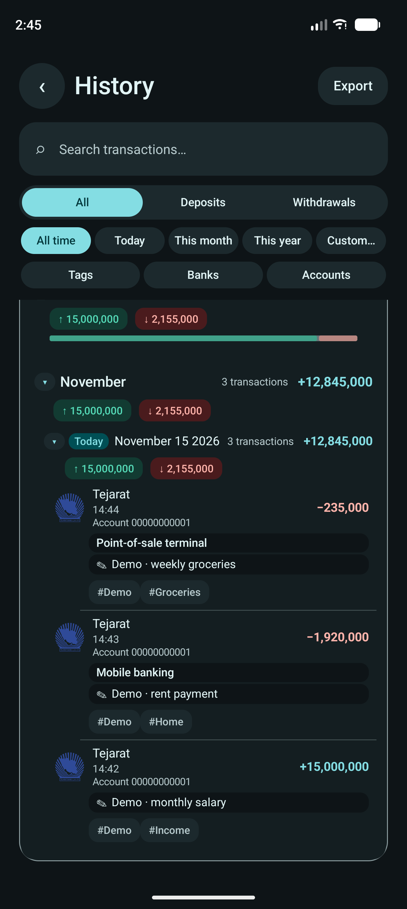
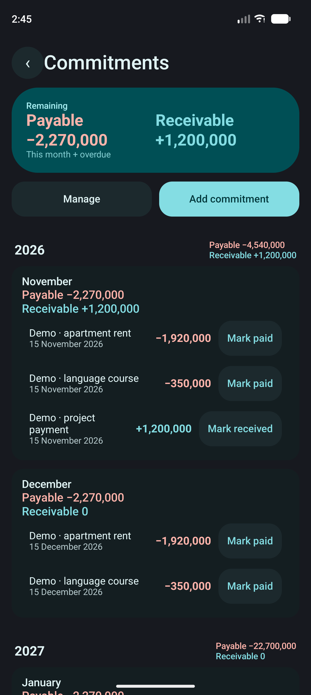

  

<h1 align="center">Balance</h1>

  <strong>A clearer picture of your money. Without giving up your privacy.</strong>
   
  No internet access · No sign-up · No ads or tracking

  <a href="https://github.com/ashkanrafiee/balance/releases">Download APK</a> ·
  <a href="https://f-droid.org/en/packages/com.ashkanrafiee.balance/">F-Droid</a> ·
  <a href="https://cafebazaar.ir/app/com.ashkanrafiee.balance">Cafe Bazaar</a> ·
  <a href="https://myket.ir/app/com.ashkanrafiee.balance">Myket</a>

Balance turns the bank SMS already on your Android phone into an overview of your balances and transaction history, with tools to plan upcoming payments. No bank login. No cloud connection. Just your money, easier to understand.

> **Built for Persian SMS from Iranian banks and selected financial services.** Other countries and message formats are not currently supported.

## Private by design, not just by promise

Balance has **no internet permission**. Your messages are processed on your phone, not uploaded to a server. There are no ads, analytics or tracking, and the app is [free and open source](LICENSE).

- **Protect what you keep.** Saved financial records are encrypted. Add an optional PIN, password or fingerprint lock.
- **Choose what others see.** Hide balances on demand, with optional automatic hiding. Balance hiding is off by default.
- **Stay in control of sharing.** Export CSV or create password-encrypted backups where you choose. CSV files are **not encrypted**; backups also contain saved bank-message samples.

## More than a balance checker

| Benefit | What you can do |
| --- | --- |
| **Your money at a glance** | See balances across banks and accounts, choose which count toward your total, and spot out-of-date figures. |
| **History you can make sense of** | Explore deposits and withdrawals, search and filter your history, and add private notes and tags. See payment details when the bank's message includes them. |
| **Clarity when something is missing** | Check the bank messages behind your figures when available. Spot balance changes the available transactions don't explain, without inventing missing payments. |
| **A plan for what's next** | Track one-off and recurring payments and money you're expecting, with reminders and separate totals for what you owe and what's owed to you. |

Make it yours with **Persian or English**, Persian or Gregorian calendars, Toman or Rial amounts, light or dark themes, and a home-screen widget.

## A look inside

  
  
  

## Before you start

Balance needs **SMS access** to read supported messages. It does not connect to your bank: missing messages can leave gaps, and the latest SMS balance may not be your current balance. Accounts are shown separately when Balance can recognize their account numbers. Android restrictions can delay reminders.

Available for **Android 8.0+**. [Obtainium](https://obtainium.imranr.dev/) can keep GitHub downloads updated.

## Help Balance grow

Found a message that isn't recognized? Use **Report** in the app or [open an issue](https://github.com/AshkanRafiee/balance/issues). Review message samples and remove private information before sharing. See [help and contributing](CONTRIBUTING.md) for more guidance.

## Donate

If Balance makes your day a little easier, you can [support its development](https://balance.ashkanrafiee.com/#donate).
